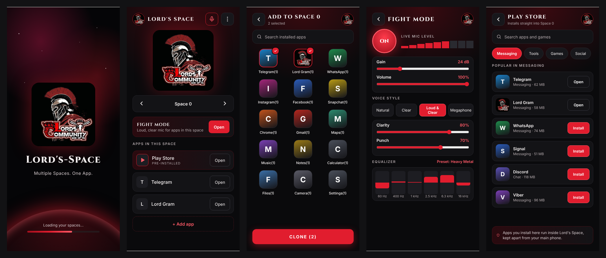

  

<h1 align="center">Lord's-Space</h1>

<b>Multiple Spaces. One App.</b>

Lord's-Space runs extra copies of your apps in separate, isolated **spaces** on one phone, with a built-in
**Fight Mode** for a loud, clear microphone.

It is built on the open-source [NewBlackbox](https://github.com/ALEX5402/NewBlackbox) engine (Apache-2.0), which
runs on current Android versions, instead of the old MultiApp engine.

*The picture is the design the app follows. The real app can differ slightly in spacing and glow.*

## What it does

- **Spaces**: Space 0, 1, 2 ... Switch with the arrows on Home. Each space keeps its own apps and data.
- **Add apps**: "+ Add app" lists the apps on your phone with search. Select and tap **CLONE**.
  Apps made of one APK are copied into the engine's own storage, so the clone keeps working even if you delete the
  original. Apps made of several (split) APKs stay linked to the phone's copy, so keep those installed.
- **Google Play in a space**: the Play Store row sets up Google services in the space and opens Play inside it.
- **Fight Mode**: ON/OFF, gain up to 100 dB, volume, voice styles, clarity, punch (compressor), 13 EQ presets and a
  6-band equalizer, noise gate and soft limiter. **Test microphone** shows the effect with no cloned app needed.
- **Mic hook for cloned apps (experimental, off by default)**: when switched on in Fight Mode, the microphone of
  cloned apps that use the Java `AudioRecord` API goes through Fight Mode too. Switch it on, then close the cloned
  app completely and open it again from Home.
- **App loader** with the logo, and a **crash report** dialog on the next start if the app ever crashes.
- No ads, no locked options.

The original NewBlackbox screens are still inside: Home menu > "Original BlackBox screen".

## Build

Android Studio is not needed, GitHub can build it:
1. Create a (private) GitHub repository and push this folder to it.
2. Open the **Actions** tab and run **Build APK** (it also runs on every push).
3. Download the `Lords-Space-debug-apk` artifact. It contains the APK(s); for a normal phone use the
   `arm64-v8a` one (or `universal` if present).

Locally: JDK 21, Android SDK 35, NDK 29.0.13846066, CMake 3.22.1, then `./gradlew :app:assembleDebug`.

Builds are signed with the fixed key in `app/lords-space.keystore`, so a new APK installs over the old one and keeps
your clones. The key is in the repository, so keep the repository **private**.

## Project status

Early build, **not tested on many phones yet**. The stock NewBlackbox engine was checked to clone and open an app on a
Xiaomi/HyperOS phone with Android 14. Lord's-Space itself (new screens, Fight Mode, the mic hook) is still being tested.

## Credits and license

- Engine: [NewBlackbox](https://github.com/ALEX5402/NewBlackbox) (Apache-2.0), itself based on BlackBox / VirtualApp
  ideas. Its original README is in `docs/README-NewBlackbox.md`.
- Method hooking for the mic hook: [Pine](https://github.com/canyie/pine) (Anti-996 license).
- Headline font: Cinzel (SIL Open Font License, `app/src/main/assets/fonts/OFL-Cinzel.txt`).
- Icons: Material Design icons (Apache-2.0). Logo: Lords Community.

Lord's-Space is released under the **Apache License 2.0** (see `LICENSE` and `NOTICE`).
